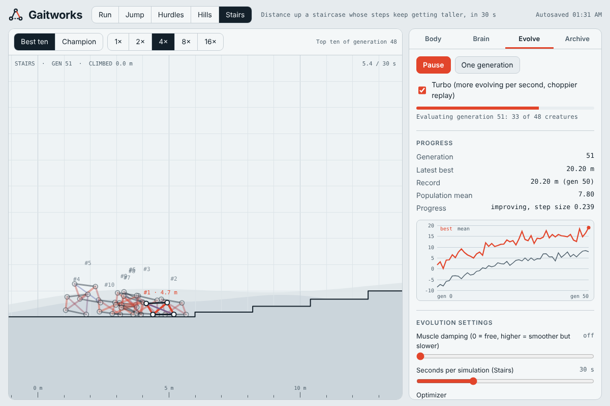

# Gaitworks

Design 2D creatures from **joints, rigid weighted bones and contracting muscles**, then let a neural network evolve to
make them **run, jump, clear hurdles, cross hills and climb stairs**. Everything runs in the browser from a single
static page, and your evolved generations are stored so you never start from scratch.

**[▶ Try the live demo](https://mpragliola.github.io/gaitworks-ai-creatures/)**



## What you can do

| Area | What it offers |
|---|---|
| **Body** | Place joints, connect them with rigid bones (each with a weight) and muscles that contract and expand. Muscles attach to joints or to the midpoint of a bone. Presets: Crawler, Strider, Biped, Inchworm. |
| **Brain** | A configurable multilayer network: 0–3 hidden layers of 2–32 neurons, tanh / leaky-ReLU / sine activations, optional rhythm clock, optional memory of its last outputs, optional "stuck sense". |
| **Evolve** | CMA-ES (default) or a genetic algorithm. Auto-restarts when stalled, a gait gallery (MAP-Elites) of distinct styles, turbo mode, adjustable seconds per simulation, muscle damping, "Shake up" to escape a rut. |
| **Tasks** | Run, Jump (height), Hurdles, Hills (three layouts scored together), Stairs (steps that keep getting taller). |
| **Archive** | Autosave in the browser, named snapshots, and JSON export/import of a whole session. |

## Run it locally

```bash
npm run build      # writes dist/index.html (one self-contained page)
npm test           # physics and optimizer sanity tests
npx serve dist     # or just open dist/index.html in a browser
```

No dependencies are needed to build or test; Node 18+ is enough.

## How it works

- **Physics:** a custom 2D position-based solver (4 substeps × 3 iterations at 60 Hz). Bones are rigid distance
  constraints; muscles are soft constraints with a force cap and activation smoothing; terrain is a one-sided polyline
  with friction. Joint speed is capped after every step, and hinges cannot fold through themselves.
- **Senses:** muscle lengths, each joint's position, velocity and ground contact, body height and speed, the ground
  height 1, 2 and 3.5 m ahead, plus the optional clock, memory and stuck inputs.
- **Scoring:** furthest distance for the course tasks, `3 × clearance + rise` for Jump, with a small penalty for time
  spent barely moving. Dead creatures score −5.
- **Optimizer:** a separable CMA-ES samples the population around a moving centre brain and adapts a step size per
  weight; the genetic algorithm (elites, tournament selection, crossover, Gaussian mutation) is still available.

## The AI gears

Every creature is steered by a small feed-forward neural network that is trained by evolution, not by gradients.

**1. The brain (per creature, per physics step)**
- *Inputs:* each muscle's stretch, each joint's position relative to the centre of mass, its velocity and ground contact,
  body height and velocity, ground height 1, 2 and 3.5 m ahead, a bias, plus the optional clock (sin/cos), memory of the
  last outputs and "stuck sense".
- *Hidden layers:* 0-3 layers of 2-32 neurons (tanh, leaky-ReLU or sine).
- *Outputs:* one tanh value per muscle, smoothed and slew-limited into a contraction target. The genome is simply the flat
  list of all weights and biases.

**2. The optimizer (per generation)**
- **Separable CMA-ES (default).** Keeps one centre brain and a per-weight step size, samples the whole population around
  it, and moves the centre towards the best half. Fast, but it is a single Gaussian, so it tends to settle on one gait.
- **Genetic algorithm.** Elites, tournament selection, crossover and Gaussian mutation with stall-driven boosts and
  fresh random blood.

**3. The diversity gears (keep them from getting stuck)**
- **Auto-restarts.** When CMA-ES stalls for 20 generations (or its step size collapses), a new run begins. Restarts
  alternate between a *random brain with a larger population* (IPOP, to find a new basin) and a *branch from a random
  elite in the gait archive with a small step* (to refine a different style). The global record is never lost.
  Toggle it in the Evolve tab.
- **Gait gallery (MAP-Elites).** Every evaluated brain is described by how it moves: the share of joints on the ground
  and how often contacts change (step rate). An 8x8 grid keeps the best brain per cell, so distinct gaits (hopper,
  crawler, galloper...) are stored side by side, even when a different style scores lower. Click a cell in the gallery
  to watch that gait. The archive is saved with the session and clears when the task changes.

## Project layout

```
src/head.html   page shell, styles and markup
src/core.js     physics, terrain, neural network, optimizers
src/app.js      editor, replay, charts, persistence
scripts/build.sh   concatenates src/ into dist/index.html
test/core.test.js  sanity tests
```

## Deployment

Pushing to `main` runs `.github/workflows/deploy-pages.yml`: tests, build, then publish `dist/` to the `gh-pages`
branch with `keep_files: true` (same approach as the pedalboard-planner repo). In the repository settings, set
**Pages → Source** to **Deploy from a branch → `gh-pages` / root** once; the site then lives at
`https://mpragliola.github.io/gaitworks-ai-creatures/` as its own subfolder, so other project sites are not affected.
